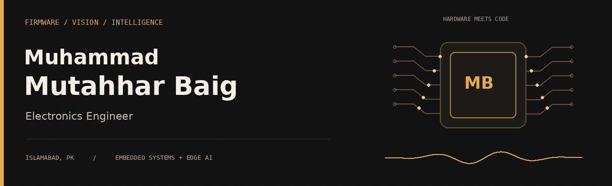
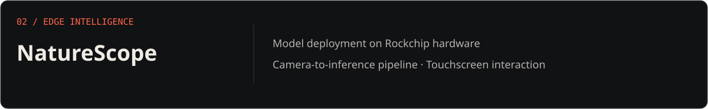
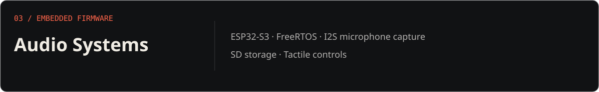

<picture>
  <source media="(prefers-reduced-motion: reduce)" srcset="assets/banner-static.png">
  
</picture>

  
  
  

 

### From a trained model to a working device.

I’m **Mutahhar**, an Electronics Engineering graduate from **UET Taxila**, based in **Islamabad, Pakistan**. I build firmware, integrate sensors, and deploy machine-learning models on hardware with real compute and memory limits.

My work spans **embedded audio, computer vision, and autonomous systems**—connecting C/C++ and Python with the physical world.

 

<a href="https://mutahharbaig.github.io/#projects">More engineering work ↗</a>

 

**Firmware & hardware**  
`C / C++` `ESP32-S3` `STM32` `FreeRTOS` `ESP-IDF` `Raspberry Pi` `Pixhawk`

**AI & computer vision**  
`Python` `PyTorch` `TensorFlow` `OpenCV` `MediaPipe`

**Model deployment**  
`ONNX` `RKNN` `TensorFlow Lite` `Quantization` `RK3588`

**Signals & systems**  
`MATLAB` `ECG / PCG` `I2S audio` `Verilog` `Sensor integration`

 

---

  <b>Have a device, an idea, or an engineering challenge?</b>  
  <a href="https://www.linkedin.com/in/engr-muhammad-mutahhar-baig-91586a324/">Let’s talk ↗</a>

